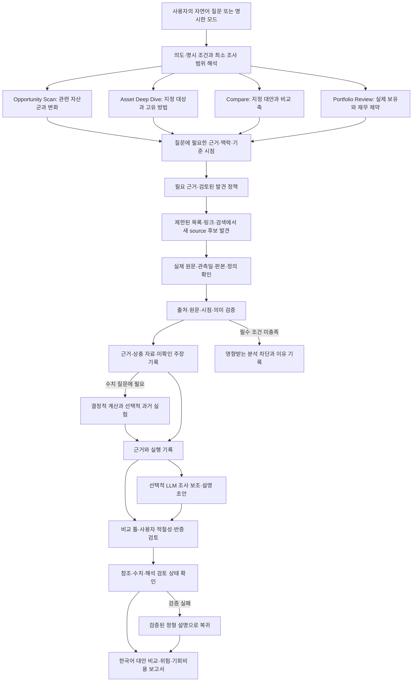

# 제안 아키텍처

2026-10-07 추가한 [투자 판단 순환](investment-cycle.md)은 아래 기존 수집·근거 계약 뒤에 연결한다. `decision_data.py`의 시점/정의 계약, `backtest.py`의 다음 관측 진입·독립기간 검증, `investment_cycle.py`의 승인/행동/배분, `decision_journal.py`의 불변 판단·전략·성숙 결과, `decision_report.py`의 결론 우선 보고서를 같은 CLI 안에서 실행한다. 새 서비스나 LLM 결정 권한을 추가하지 않았다. Broad Scan의 기본 승인 부재 판단과 선택적 등록 전략 판단을 구분하며 저장 실행의 버전 marker로 이전 보고서를 그대로 재현한다. 2026-10-22에는 `history.py`가 검토된 공개 제공자(Upbit 일 캔들·ALFRED 판본)에서 같은 시점/정의 계약의 장기 이력을 만든다. 기존 HTTPS 접근 경계를 쓰고 보존 행으로 오프라인 재현하며, 판단 권한은 갖지 않는다.

## 1. 선택: 로컬 CLI로 시작하는 모듈형 단일 애플리케이션

한 명의 사용자가 로컬 또는 개인 클라우드 환경에서 연구를 실행하는 Python CLI 애플리케이션을 사용한다. 합성 오프라인 브리프, 실제 공개 자료·출처 검증, 거시 시계열과 Macro Regime Snapshot, 실제 Opportunity Map 및 첫 미국 주식 Deep Dive가 있다. 아래는 이 구현을 포함한 전체 설계이며 모든 자산 분석이 구현된 것은 아니다. 실행 흐름은 명시적인 단계로 구성하고 모듈은 함수와 자료형 계약으로 연결한다. 네트워크 서비스, 메시지 큐, 다중 에이전트, 분산 데이터베이스는 도입하지 않았다.

이 선택은 작은 팀에서 출처·질문·근거 검토에 집중하기 쉽고, LLM 없이도 구조화된 연구 자료와 정형 보고서를 재현할 수 있다는 장점이 있다. 이후 웹 화면은 동일한 연구 실행을 호출한다. 가격 계산·백테스트 엔진은 이 실행의 선택적 도구이며 전체 제품의 중심이 아니다.

실행의 시작점은 **사용자의 실제 투자 질문**이다. 넓은 기회 탐색, 특정 자산·전략, 지정 대안의 비교, 실제 보유 검토를 독립적으로 지원한다. 명시한 모드를 우선하고 그렇지 않으면 질문으로 해석한다. Opportunity Scan은 다른 모드의 선행 조건이 아니다. 기준 시점과 질문에 필요한 사용자 맥락을 고정하고, 답에 충분한 최소 범위·방법·근거를 선택한다. Portfolio Review는 실제 보유와 재무 제약부터 시작하며, 개인 정보가 없으면 영향을 받는 결론을 제한한다. [연구 진입점 계약](research-modes.md)을 따른다.

LLM은 허용된 근거에서 질문·가설·원문 추출·해석 초안을 제안할 수 있다. 데이터 획득·계산·사실 확정·배분 결정의 권위가 아니며, 추출도 원문 대조와 검토 상태 확인을 거친다. 새로운 사실을 모델 기억으로 보충하거나 자료를 수정할 권한은 없다. 최종 해석의 의미를 자동 검증했다고 주장하지 않는다.

현재 구현의 검증 단계에는 [Source Anomaly Guard](source-anomaly-guard.md)를 추가했다. 동일 제공자 충돌·극단적 관측·등록 단위/경제적 정의·미완성은 기존 EvidenceRecord의 검증 상태와 별도 audit으로 격리해 claim·계산·coverage 사용을 제한한다. [원자재 심층 계약](commodity-deep-dive.md)은 이 기존 모듈형 실행에 자료와 산술을 추가하며 새로운 routing/수집/연구 architecture를 만들지 않는다.

## 2. 책임과 경계

| 책임 | 입력 → 출력 | 해야 할 일 | 경계 |
| --- | --- | --- | --- |
| 의도·연구 범위·실행 | 자연어 질문·명시한 모드·관련 맥락 → 조사 계획·실행 상태 | 독립 모드·대상·고유 방법·필수 자료·최소 범위·필요한 조합 선택 | Scan을 모든 진입점의 관문으로 만들지 않음; 인기도·나이에서 매력·비중을 도출하지 않음 |
| 출처 발견·선택 | 질문 need·검토된 발견 정책 → 후보·선택/거절·freshness·SourceSpec | 공개 목록·발행자 링크·검색의 실제 source를 열고 최신 판본·canonical·정의·누락 확인; 현재 BTC로 검증 | snippet을 evidence로 사용하지 않음; 미검토 형식·모든 금융사이트 crawling·LLM source truth는 미지원 |
| 외부 자료 확보 | 명시한 또는 발견·검증한 SourcePlan·SourceSpec → Snapshot과 획득 기록 | 기존 bounded 공개 HTTPS GET·정책 확인·보존·실패 진단 | 원자료를 투자 결론으로 만들지 않음; replay·plan-only는 조회하지 않음 |
| 검증·정규화 | 원자료·문서·명세 → 관측·출처 구절·품질·검증 상태 | 식별자, 단위·시점, 가격의 의미, 원문과 주장, 출처 의존 확인 | 출처 등급이나 인용 존재만으로 내용·해석을 사실로 확정하지 않음 |
| 정량 계산 | 검증된 자료·방법 설정 → 계산 결과 | 수익률, 낙폭 등 지원하는 지표와 적용 조건 계산 | LLM 문장을 숫자 입력으로 신뢰하지 않음 |
| 백테스트 | 시점이 보장된 자료·사전 등록된 가설 → 검증 결과 | 정보 이용 가능 시점, 거래 시점, 비용, 표본 외 평가 | 일반 과거 요약을 전략의 백테스트라고 부르지 않음 |
| 근거 기록 | 관측·구절·계산·검증 기록 → 참조 가능한 근거 묶음 | 출처·버전·시점·범위·불확실성·상충·원출처 의존 연결 | 반복된 기사·게시물을 독립적인 증거로 세지 않음 |
| 대안·사용자 비교 | 근거·비교 틀·프로필 → 조건부 비교·확인할 제약 | 기회비용·유동성·집중위험·접근성·자금수요 확인 | 다른 성격의 수익 지표를 단일 점수·최적 비중으로 바꾸지 않음 |
| 해석·반증 | 근거·질문·가정 → 주장과 반대 검토 | 인과와 상관 구분, 대안 설명, 무효화 조건 | 추정치를 관측 사실로 승격하지 않음 |
| 설명·보고서 | 검증된 주장·근거 → 한국어 보고서 | 수치 삽입, 근거 링크, 용어 설명, 제한 공개 | 누락 결과를 매력적인 표현으로 보충하지 않음 |

첫 구현에서 각 책임을 별도 클래스로 만들 필요는 없다. 경계가 확인되는 작은 함수와 타입부터 두고, 실제 중복이나 자산별 차이가 생길 때만 확장한다.

### 네 조사 관점은 같은 종류의 증거가 아니다

| 관점 | 주된 역할과 필요한 자료 | 결과와 한계 |
| --- | --- | --- |
| Macro · 거시 | 물가·고용·성장·금리/곡선·통화정책·통화량/유동성·신용·재정·환율·상품가격 중 질문의 전파 경로에 관련된 항목 | 환경·시나리오·자산 간 연결. 여러 지표의 동행을 원인·매매 시점으로 단정하지 않음 |
| Fundamental · 사업·기초가치 | 매출·이익·마진·현금흐름·재무상태·가치평가, 이익 추정과 수정, 산업·경쟁·가이던스·수급·촉매·위험 | 현금 창출력과 가치·실패 경로. 회사 전망·컨센서스는 확정 실적이 아니며 PER만으로 판단하지 않음 |
| Quantitative · 정량 | 정의된 입력의 수익·위험·민감도·과거 사례·필요한 가설 실험 | 재현 가능한 수치와 통계적 한계. 가격만으로 사업·사용자 적절성을 대신하지 않음 |
| Community / narrative · 참여자 의견 | 공개 토론의 주장·관심·우려·확산, 새로운 가설과 검증할 질문 | 관측한 출처·기간 내 내러티브. 대표성·진실·수익 예측력은 별도 검증 대상 |

이 관점은 별도 서비스나 에이전트가 아니다. 한 조사 계획 안에서 자료와 주장 유형을 구별하는 역할이다. 지표를 많이 수집하기보다 “이 자료가 어떤 투자 논리를 바꾸는가?”를 먼저 명시한다.

### 질문에 맞는 분석을 선택한다

연구 요청은 대상과 기간뿐 아니라 답하려는 질문을 지정한다. 분석은 필요한 입력과 적용 전제를 선언하고, 조건이 충족될 때만 실행한다. 특징값·지표 변환도 정량 계산의 일부이므로 정의와 버전을 기록한다.

| 질문의 예 | 필요한 분석과 자료 | 제한 |
| --- | --- | --- |
| 가격이 사업 실적에 비해 높은가? | 해당 시점 재무·이익·현금흐름과 가격, 비교 집단·가치평가 가정 | 배수가 낮다는 사실만으로 저평가나 미래 수익을 확정하지 않음 |
| 최근 움직임은 어떤 환경에서 나타났나? | 모멘텀·추세·변동성, 금리·유동성·시장 상태 | 상태와 지표 선택에 미래 정보를 사용하지 않음 |
| 천연가스 아이디어의 공급·수요 근거는 무엇인가? | 지역별 재고·날씨·수급, 공개 시점, 선물곡선·상품 구조 | 계절·재고만으로 투자 성과를 주장하지 않음 |
| 비슷한 과거 조건 이후 결과는 어땠나? | 미리 정의한 조건, 당시 자료, 전방 수익 분포와 의존성 | 표본 선정과 다중 탐색을 기록하고 미래 확률과 분리 |
| 금리 변화에 채권은 얼마나 민감한가? | 계약상 현금흐름·가격·수익률곡선, 기간·신용·재투자 가정 | 민감도나 만기수익률을 확정 기간수익으로 표시하지 않음 |

가치평가·모멘텀·거시·유동성·포지셔닝은 모두 가능한 도구이며 필수 체크리스트가 아니다. 포지셔닝 같은 제공자 추정 자료는 관측 가능한 실제 전체 시장 포지션과 구분한다. 사용할 수 없는 분석은 이유를 남기고, 점수를 채우기 위한 대체 지표를 조용히 끼워 넣지 않는다.

## 3. 핵심 데이터 계약

아래는 전체 설계의 의미상 계약이다. 합성 연구 경로는 [오프라인 구현 안내](offline-mvrs.md#자료형과-파일), 실제 자료 경로는 [출처 획득·검증 안내](source-acquisition.md), 실제 거시 시계열은 [거시 MVP 안내](macro-mvrs.md)에 구분한다. 이 표의 모든 계약이 별도 클래스나 기능으로 구현된 것은 아니다.

| 계약 | 최소로 보존할 내용 |
| --- | --- |
| ResearchRequest · 질문 의도 | 원래 사용자 질문, 명시/해석한 모드·대상·국가·지역·만기/기간·전략·의사결정·시점·명시 제약·제외 범위·모호한 항목; [query understanding](query-understanding.md)으로 보존하고 미지원 조건을 다른 조건으로 대체하지 않음 |
| ResearchBrief · 연구 질문 | 기준 시점, 실제 투자 질문, 관련 목표·기간·KRW·프로필 참조·대안 범위, 판단에 필요한 근거와 제한 |
| ProfileSnapshot · 사용자 맥락 | 버전·확인 시점, 자기보고 정보·unknown, 보유범위, 현금흐름·부채·자금수요·주택 계획·capacity/tolerance |
| MarketContext · 시장 맥락 | 선택한 거시 질문·관측·전파 경로·시나리오·자료 기준 시점; 관련 없는 지표는 제외 |
| ResearchPlan · 조사 계획 | 명시/해석한 독립 모드·작업·대상·방법, 필요한 자료/개인 맥락·최소 범위·실제 의존·확인할 질문; Scan 후보 검토는 해당 모드에서만 수행 |
| ComparisonFrame · 대안 비교 틀 | 대안·기간·통화·수익 정의·유동성·비용·세금 상태·손실 경로·불확실성, 축별 비교 가능 여부와 조건 |
| SourcePlan · 명시한 획득·검증 계획 | 질문·기준 날짜, SourceSpec 목록, 선택 구절·정의·주장·검토 기록, 입력 해시; 자동 조사 계획과 구분 |
| SourceSpec · 획득 대상 | 요청·canonical URL, 출처 종류·발행 주체·제목, 공개·관측·유효 시점, 관할·주제, 접근·보존 정책, 구절 선택과 최신성 기준 |
| Snapshot · 보존된 획득 결과 | 변경하지 않는 식별자, 획득 시각·상태·HTTP/정책 기록, 수신 원문·정규화 내용·보존 payload의 해시, 보존 구절·실패 진단 |
| SeriesDefinition · 거시 시계열 정의 | canonical ID·이름·의미, 단위·빈도·계절조정·통화 맥락·발행 주체·source, raw/변환, 공개·개정 특성, 명목/실질·만기·신선도 한도; 같은 ID의 정의 변경 거부 |
| MacroObservation · 거시 원관측 | 값 또는 명시적 결측, 관측 기간·공개·획득·vintage·revision·known-at·valid-as-of, snapshot과 원문 위치; 수정 전후 판본을 덮어쓰지 않음 |
| MacroMetric / MacroSnapshot · 거시 계산·상태 | 고정 기준 시점의 선택·제외 판본, 계산 공식·입력 ID·관측창·단위·가정·상태·방향·진단; 기존 근거·계산 타입으로 연결 |
| Instrument · 상품 | 안정적인 내부 ID, 상품 종류, 상장 시장·제공자 ID, 거래 통화, 연결된 기초 노출, 가격·수익 데이터 의미 |
| Observation · 관측 | 상품·항목 ID, 값·단위·통화, 관측 대상 시점, 공개 시점, 실제 접근 가능 시점, 획득 시점, 자료 개정 버전, 출처 참조 |
| SourceRecord · 출처 | 발행 주체·정보원 유형·위계, 원문 참조·구절·시점, 접근·이용 조건, 원출처·중복 관계; 현재 optional SourceProvenance로 snapshot·보존·최신성 연결 |
| DatasetManifest · 자료 명세 | 제공자·원본 참조, 체크섬, 기간·달력·시간대, 조정·배당·환율 정책, 라이선스 상태, 자료 버전, 검증 결과 |
| MetricResult · 계산 결과 | 값·단위, 정의, 분석 기간·통화, 입력 ID, 방법·코드 버전, 관측수 또는 유효 표본수, 적용 전제, 한계, 상태 |
| EvidenceRecord · 근거 | 관측·원문 구절·계산 참조, 주장 유형, 질문·자산·기간·지역 범위, 품질·검증 상태; 현재 optional EvidenceProvenance로 구절 일치·정의·최신성 연결 |
| ResearchClaim · 주장 | 문장 유형, 지지·반대·context_ids 배경 참조, 가정·추론 과정, 사실 검증과 해석 검토 상태, 적용 범위, 무효화 조건 |
| AllocationScenario · 배분 시나리오 | 사용자 지정·명시된 가정의 대안, 필요 자금·유동성·노출·제약, 계산 가능한 변화와 미확인 결과; 최적화 판정 아님 |
| RunManifest · 실행 기록 | 실행 ID, 설정과 방법 버전, 입력 체크섬, 코드 식별자, 의존성 버전, 실행 시각, 결과 상태, 산출물 참조 |

이 계약들은 의미상의 경계다. 첫 구현은 필요한 필드를 작은 로컬 자료 묶음에 담는다. 계약마다 별도 테이블·클래스·서비스를 만들거나 지식 그래프를 도입할 필요는 없다. 상품 없는 거시 관측과 지역 부동산 질문도 가능해야 하며, 모든 자료에 티커를 강제하지 않는다.

자료 계약은 단위를 명시한다. 퍼센트와 비율, KRW와 USD, USD/KRW와 KRW/USD, 배럴과 에너지 단위는 서로 다른 타입이나 검증된 필드다. 티커만으로 종목을 식별하지 않는다. 시장·상품·시점에 따라 같은 티커가 다른 대상을 뜻할 수 있다.

### 서로 다른 근거의 결합

각 주장에 원문·관측·계산을 연결하고, 어떤 질문을 얼마나 직접 뒷받침하는지, 어느 범위에서 상충하는지 기록한다. 출처 위계는 확인할 원자료의 우선순위이며 자동 진실 점수가 아니다. 기업의 가이던스, 거시 통계, 커뮤니티의 걱정은 서로 다른 성격의 근거다. 같은 보고서를 재인용한 여러 기사는 하나의 원출처를 공유한다.

비교·해석은 **지지 근거, 반대 근거, 배경 자료, 명시한 가정, 추론, 미확인 항목**을 갖는다. 수치와 참조·시점·범위의 구조적 일관성은 코드가 확인하고, 비수치 사실과 해석은 원문 대조·명시적인 검토 기록이 필요하다. 현재 코드가 확인하는 구절 존재·지원 수치의 일치를 경제적 일반 주장이나 상대 우위의 자동 확정으로 확대하지 않는다. 명시한 사례 검토 기록을 그 근거·범위와 함께 보고하며, 이후 조사 보조가 초안을 제안해도 의미 검토를 거쳐 조건부 비교로 채택한다. `context_ids`는 맥락을 보존하며 지지·반대로 자동 승격하거나 결론 강도를 높이지 않는다. LLM 초안의 구조가 유효해도 의미 검토 전에는 검토 완료된 인사이트로 게시하지 않는다. 상세 규칙은 [리서치 신뢰성](research-integrity.md)에 둔다.

### 시점은 하나가 아니다

- `observed_at` 또는 관측 기간: 가격이나 경제 활동이 발생한 시점.
- `published_at`: 제공자나 기관이 공개한 시점.
- `available_at`: 지정한 데이터 경로에서 실제로 사용할 수 있었던 시점.
- `retrieved_at`: 이번 시스템이 가져온 시점.
- `valid_as_of`: 해당 내용이나 관측이 설명하는 유효 시점. 현재 획득했다는 이유로 현재 상황을 설명한다고 가정하지 않는다.
- `vintage`: 개정 전후 자료 버전.
- 거시 원관측의 `released_at`, `revised_at`, `known_at`: 해당 관측의 공개·수정·특정 판본을 알 수 있던 순간. source 문서의 발행일이나 CSV 파일 생성 시각과 구분한다.

모르는 시점은 `unknown`으로 둔다. 실제 자료의 발행·관측 날짜는 미확인이 가능하며 획득 시각으로 채우지 않는다. 현재 웹 자료의 과거 이용 가능성을 증명하지 못하면 `available_at`도 미확인이다. 현재 개정된 자료로 하는 기술적 분석은 허용할 수 있지만, 과거 시점에 가능한 판단을 재현하는 실험에는 정보 기준 시점 이전에 이용 가능했던 버전이 필요하다. 정보 시점이 불명확한 재무·거시 자료는 그 실험에서 제외한다.

거시 선택은 관측 기간이 과거여도 공개·vintage·revision·known-at·유효 시점이 cutoff 이후이면 제외한다. 실제 공개 시점이나 개정 이력을 모르면 현재 확보한 판본의 획득 시각을 보수적인 이용 가능 하한으로 사용한다. 이 하한을 원래 공개 시각이나 공식 vintage로 부르지 않는다. 날짜만 지정한 거시 cutoff는 UTC 일말이며, 한국 시각의 특정 순간은 timezone을 포함한 timestamp로 지정한다.

`sources replay`의 출처 최신성은 고정된 연구 날짜와 SourceSpec의 유효·관측·공개 시점, 자료별 허용 나이로 평가한다. 알려진 미래 날짜가 있으면 발행일 미확인보다 `future`를 우선한다. `stale`, `unknown`, `future`는 현재 투자 근거 채택을 유보하는 이유이며, 과거의 좁은 사실 확인과 별개다. 거시 경로는 별도로 관측별 이용 가능 하한과 나이를 검사한다. 기록된 근거 검토 날짜는 관측·획득보다 앞설 수 없고 주장 검토는 참조 자료의 분석·검토보다 앞설 수 없다. 날짜만 있는 검토 기록은 같은 날짜 안의 시간 순서를 보증하지 않는다.

### 결과의 상태

계산 결과는 `available`, `not_applicable`, `blocked`를 구분한다. 실행은 `completed`, `partial`, `blocked`, `failed`를 구분한다.

- `not_applicable`: 해당 상품이나 질문에 맞지 않는 지표.
- `blocked`: 필요한 데이터 또는 검증 전제가 부족해 계산하지 못함.
- `failed`: 구현·실행 오류가 발생해 조사해야 함.
- `partial`: 독립적인 일부 결과만 유효함. 누락된 핵심 결과에 의존하는 주장은 게시하지 않음.

누락 값을 0으로 저장하지 않는다. 관측수와 유효 표본수도 구분한다. 겹치는 기간의 수익률은 여러 관측을 만들 수 있지만 서로 독립적인 표본이 아닐 수 있다.

실행 완료와 투자 결론의 강도는 다르다. 조사를 끝내도 `insufficient_evidence` 또는 `conditional`이라는 결론 상태가 정상적이다. 상충 자료를 기록하고 결론을 유보한 연구를 실행 오류로 표시하지 않는다. 필수 입력이 없어 계획한 비교를 못 했다면 `partial` 또는 `blocked`로 구별한다.

## 4. 저장과 기술 선택

| 선택 | 초기 제안과 도입 시점 | 이유와 한계 |
| --- | --- | --- |
| 언어·실행 | 현재 Python 3.12 이상, 표준 라이브러리 CLI·unittest | 3.12.14에서 검증했다. Python 패키지 의존성·uv·잠금 파일을 추가하지 않았다. 작은 삼성 공식 PDF의 live 전사에만 선택적 bounded `pdftotext`를 사용하며 없으면 gap으로 처리한다. Replay·기본 테스트에는 필요 없다. |
| 자료형 | 현재 dataclass·StrEnum과 엄격한 JSON 검증 함수 | 이 작은 계약에는 Pydantic을 추가하지 않았다. 누락·미지원 필드·잘못된 참조를 입구에서 거부하되 금융 의미 검토는 별도다. |
| 계산 | 현재 Decimal의 연율 격차·정책변화 구절 변환·좁은 수치 비교와 거시 YoY·금리 차이·관측 변화; NumPy/pandas는 필요할 때 도입 | 거시는 고정 precision 50·ROUND_HALF_EVEN으로 계산한다. 입력 정의·단위·통화와 방법 버전을 확인하며 미래 실질수익이나 자산 우열로 확대하지 않는다. |
| 입력 | 합성 JSON 연구 묶음, SourcePlan 또는 MacroPlan·고정 snapshot 참조; 실제 BLS JSON·Fed CSV 어댑터 | replay는 오프라인이며 원관측·공개/판본 metadata·검토 기록을 보존한다. 형식만으로 의미를 보장하지 않는다. |
| 원자료·산출물 | 변경하지 않는 snapshot JSON, 권리에 따른 전체/구절 보존, 세 종류 해시, Markdown·실행 기록 | 전체 보존은 명시한 권한이 필요하다. 구절만 보존한 경우 삭제한 전체 원문을 replay에서 다시 검산하지 못한다. |
| 이후 로컬 저장 | SQLite로 연구·출처·실행 목록, 필요해지면 Parquet로 시계열 | 단일 사용자에 충분하다. 동시 쓰기와 데이터 규모가 실제 병목이 되면 재평가한다. |
| 보고서 | Markdown 또는 HTML 정형 보고서 | 검토와 공유가 쉽고, 숫자를 코드가 삽입한다. 대화형 화면은 이후 단계다. |
| LLM | 공급자에 종속되지 않은 좁은 호출 경계, 선택 기능 | 모델 없이 기본 리서치가 가능하다. 처음부터 범용 에이전트 프레임워크를 쓰지 않는다. |

JSON은 추적·교환이 편한 초기 선택이다. 근거의 신뢰성은 저장 형식이 아니라 검증된 계약, 원문·원자료와의 연결, 계산 정의와 주장 검토에서 온다. 데이터 규모가 커지면 같은 의미 계약을 유지하며 저장 형식을 바꾼다.

현재 `sources acquire`·`macro acquire`와 기본 `ask`가 검토된 공개 출처에 네트워크 요청을 수행한다. ask는 같은 acquire 함수에 질문 범위의 계획만 전달한다. 모든 replay·`ask --plan-only`·기존 `research`는 로컬 자료만 읽는다. 인증·비밀 키는 필요하지 않으며, 향후 인증 제공자를 연결할 때 도메인·자격 증명·비용·한도·이용 조건을 별도로 확인한다.

### 현재 실제 출처 경로

`SourcePlan → 명시적 acquire → Snapshot과 고정 pins → 오프라인 replay → SourceRecord / EvidenceRecord / ResearchClaim → 기존 engine·한국어 report`로 연결한다. 별도의 투자 판단 엔진은 만들지 않았다. 공개 HTTPS GET은 요청당 10초·본문 2MiB로 제한하며 redirect·접근 제한 우회를 허용하지 않는다. `public_http`는 robots 정책을 확인하고 404는 정책 파일 없음으로 기록한다. `public_api`는 검토된 정책 참조를 입력받으며 이용 권리를 자동 판정하지 않는다.

원문·정규화 내용·보존 payload를 각각 해시한다. 전체 보존을 허용한 Fed 자료와 거시 예제의 BLS API 원자료는 전체 내용·정규화를 replay에서 다시 확인할 수 있다. 구절 보존으로 설정한 자료는 필요한 구절·메타데이터만 남기므로 원문 전체의 획득 해시는 기록일 뿐 삭제한 내용을 복구하거나 다시 검산하지 못한다. HTML `locator`는 설명용 레이블이며 실제 DOM·문단 위치를 검증하는 선택자가 아니다. HTML은 정규화된 공개 텍스트에서 구절을 찾고, 지원하는 JSON 구절은 지정 필드로 연결한다.

`numeric_equality_v1`은 검토 기록과 동일 정의를 가진 지원 수치의 일치만 비교한다. `reviewed_links_v1`의 의미 판단은 명시한 사례 검토 상태를 사용한다. 둘 다 거시 인과·미래 성과·투자 우위를 자동 판정하지 않는다. 출처 실패·변경·누락 구절은 성공 근거를 만들지 않고 진단·미확인 주장을 남긴다. 상세 실행·입력·보존 계약은 [출처 획득·검증 안내](source-acquisition.md)를 따른다.

### 현재 실제 거시 경로

`MacroPlan → 기존 source collector와 고정 snapshot/pins → 원관측 파싱 → 당시 이용 가능한 판본 선택 → 결정적 변환 → 기존 SourceRecord / EvidenceRecord / MetricResult / ResearchClaim → 정형 Macro Regime Snapshot`을 구현했다. `macro.py`는 정의·시점 선택·계산, `macro_pipeline.py`는 공식 어댑터·근거 연결·manifest, `macro_report.py`는 참조 검증과 한국어 설명을 담당한다. 별도의 저장 서비스나 LLM 예측 계층은 없다.

실제 예제는 CPI-U NSA index, 2년·10년 명목 미국 Treasury 수익률, USD당 KRW 기준환율의 네 series다. 세 원자료 dataset에 CPI 공식 release URL을 추가하며, 보존한 발표 시각·관측월·지수의 세 구절을 현재 API 관측과 교차 확인한다. 발표 시각은 America/New_York timezone으로 해석한다. 다른 과거 row의 공개·개정 시각은 추정하지 않는다. Treasury 원문의 `Currency: NA`는 수익률이 화폐 금액이 아닌 비율이라는 뜻이고, 정의의 USD는 기초 국채의 통화 맥락이다.

현재 API·CSV는 확보한 판본이며 과거 공식 vintage archive가 아니다. `--previous-pins`는 같은 계획에서 이전에 확보한 snapshot을 함께 보존하고 판본별 관측을 추가한다. 미래 판본을 과거 cutoff에서 제외하며, 현재 snapshot만으로 당시 값을 복원하지 못하면 차단을 보고한다. 선택은 `available/stale/missing/blocked`, 거시 계산은 `available/stale/blocked`를 구분하고 stale 수치는 과거 기록으로만 보존한다.

YoY는 정확한 현재·12개월 전 index endpoint로 계산하고 중간 결측은 별도로 공개한다. 금리 차이는 정의가 맞는 동일 날짜의 10년−2년 수익률을 percentage points로 계산한다. 직전 관측 변화와 현재·정확한 전월 YoY 차이는 고정 규칙이며 지속 추세·원인·예측이 아니다. 보고서가 계산하거나 값을 보충하지 않으며 주요 숫자는 기존 evidence/metric과 연결한다. 자산 순위·개인 배분은 수행하지 않는다. 구현 계약과 실제 예제·한계는 [거시 MVP 안내](macro-mvrs.md)에 둔다.

이후 실제 [Opportunity Map](opportunity-map.md)이 거시 근거를 자산별 구절·반대 논리·기회비용·사용자 제약과 연결했고 [첫 미국 주식 Deep Dive](us-equity-deep-dive.md)가 예상 이익 분모·AI 투자·Treasury 비교를 조사했다. 새로운 단일 후속 질문은 [로드맵](roadmap.md#다음-codex-task-제안)에 두며 아직 수행하지 않았다.

### 현재 구현의 축소 경계

실제 [Opportunity Map](opportunity-map.md)은 명시적 source plan의 자산 목록과 고정 연구 초안을 추가한다. `opportunity.py`가 기존 source·macro replay를 호출하고 정확한 cutoff·출처/근거/계산 참조를 검사한 뒤 기존 ResearchBrief·ProfileSnapshot·Alternative·OpportunityCost·ResearchClaim·ResearchResult로 연결한다. 별도 크롤러·가격 엔진·LLM 런타임을 도입하지 않는다. `opportunity_report.py`는 채택 가능한 참조와 보류 이유를 한국어로 출력한다.

연구 우선순위는 입력된 검토 전 해석이며 자동 발견·매력 확정과 다르다. 현재 판본의 fresh 비커뮤니티 구절이 없는 후보는 자료 부족으로 낮춘다. 커뮤니티는 발언 존재만 출력하고 내용은 검증하지 않는다. 발행일 미확인·관측일 명시 데이터 페이지의 보수적 가용 하한은 정확한 획득 시각이며 과거에 소급하지 않는다. 이 경로는 실제 연구 질문·데이터의 정의·원출처 의존·개인화의 부족을 드러내는 작은 통합이다.

`ResearchBrief`의 질문·기준 시점·공통 기간·통화·비교 한계와 `Alternative`의 노출·수익 정의·유동성으로 작은 비교 틀을 표현한다. `market_context_ids`는 관련 근거를 지정하고 `excluded`는 제외 이유를 보존한다. `routing.py`는 질문·모드별 계획, `orchestrator.py`는 선택한 source/macro 획득·검증·기존 수치 방법·자기보고 Portfolio Review와 보고서를 연결한다. `research_catalog.py`는 검토된 source·definition·시점을 최소 범위로 투영하며 원출처 관계를 보존한다. 작업 의존은 사용자 요청에서 도출하고 글로벌 Scan→Deep Dive 순서가 없다. [discovery](source-discovery.md)는 검토된 공개 목록의 새 URL/판본을 발견하고, [Scan](opportunity-scan.md)은 기존 evidence와 OpportunityReview 경계로 조건부 조사 후보를 선택한다. 전체 자산의 완전한 분석·최적 배분 시나리오는 미지원이다. [실행 계약](research-orchestrator.md)에 현재 역할과 범위를 둔다.

출처·근거·주장은 별도 타입이며 계산 결과는 `MetricResult`로 연결한다. 검증된 자료의 구조와 입력 검토 상태에 따라 정형 비교를 만들고, 새 금융 사실이나 미래 수익을 생성하지 않는다. 원출처 관계는 순환을 거부하고 중복을 표시하지만 독립성·진실성을 자동 증명하지 않는다.

실행 기록은 정규화 입력·코드·보고서 SHA-256, 고정 방법 버전과 상태를 저장한다. 실제 획득 시각은 snapshot에 기록하고 replay는 고정된 입력·pins·연구 날짜를 사용하므로 실행한 날에 따라 보고서가 바뀌지 않는다. 보고서 실행 시각을 새로 삽입하지 않으며 근거 자체의 시점은 보존한다. 잘못된 필수 입력·pins·검토 날짜는 `blocked`로 종료한다. 출처 획득 실패와 replay의 정상적인 미확인 결론은 별도로 기록하며, 범용 `partial` 실행이나 계산별 `not_applicable` 객체는 향후 설계다.

## 5. 기초자산·상품·계좌 분리

다음 개념을 각각 보존한다.

1. **경제적 노출**: 예를 들어 특정 주가지수, 금, 특정 지역·허브의 천연가스, BTC 가격.
2. **투자상품**: 그 노출을 얻는 개별 ETF, 채권, 선물 계약, 현물, ETN 등.
3. **계좌와 거래 경로**: 국내·해외 계좌, ISA·연금 등과 실제 거래·환전 조건.
4. **사용자 보유 맥락**: 개인화 판단에 필요한 보유자산·부채·필요 자금·중복·손실 감당 능력을 연결하고, Portfolio Review는 실제 보유 맥락에서 시작한다. 없는 정보는 unknown이며 일반 자산 연구에 불필요한 원장을 요구하지 않는다.

같은 경제적 노출에 연결되어도 상품 결과가 같다고 가정하지 않는다. 추적 오차, 환헤지, 선물 교체, 옵션 운용, 발행기관 신용 위험, 유동성, 세금이 결과를 바꾼다. 복합 상품은 여러 노출과 가중치·기준 시점이 필요할 수 있으므로 하나의 기초자산 ID로 단순화하지 않는다.

### Cross-asset 비교와 기회비용

ComparisonFrame은 시장 매력과 사용자 적절성을 별도 축으로 기록한다. 국채·현금 수익 조건, 신용 스프레드, 물가·성장·통화정책·유동성·환율 등은 관련될 때 대안과 전파 경로의 근거로 사용한다. 모든 자산의 전망을 단일 수익 숫자로 통일할 필요는 없다.

- 국채 만기수익률, 주식의 과거 총수익·이익수익률, 부동산 임대수익률을 동일한 미래 수익률처럼 비교하지 않는다.
- 같은 기간·통화에서 가능한 현금흐름과 가치 경로를 계산하고, 가격·신용·재투자·유동성·환율 위험과 가정 차이를 공개한다.
- 비용·세금·투자 접근성·큰 자금수요를 확인하고, 비교 불가능한 축은 그 이유를 표시한다. unknown을 0으로 채워 전체 순위를 만들지 않는다.
- 포트폴리오 관점은 통화·산업·지역·유동성·직업/소득·주택 노출의 겹침을 검토한다. 평상시 상관계수나 ETF 개수만으로 분산을 확정하지 않는다.
- 배분 시나리오는 명시한 가정·제약에 따른 변화와 확인할 질문이다. 자료 없는 기대수익·최적 비중을 만들어내지 않으며 실제 결정은 사용자에게 남긴다.

## 6. 자산군 확장과 적용 조건

| 자산·상품 | 고유하게 확인할 요소 | 피해야 할 동일시 |
| --- | --- | --- |
| 미국·한국 주식, 성장·가치·배당 특성 | 사업·매출·마진·현금흐름·재무·산업·경쟁·가이던스·컨센서스와 수정, 배당·분할·상장폐지·공시 시점 | PER 또는 스타일 명칭만으로 매력 확정; 같은 특성을 별도 독립 자산으로 중복 계산 |
| 글로벌 ETF | 기초 노출, 추종·복제 방식, 배당, 보수, 환헤지, 추적 차이, 구성 변경 | ETF를 하나의 고정 자산군으로 취급; 지수와 실현 성과가 같음 |
| 국채·회사채 | 계약 현금흐름·만기·경과이자·금리곡선·duration, 신용·스프레드·재투자·유동성 | 만기수익률을 어느 기간의 확정 수익률로 표현 |
| 금·기타 원자재·천연가스 | 실물 수급·재고·지역·단위, 금의 실질금리·통화 관련 가설, 선물곡선·계약 교체·보관·계절성 | 현물 상승률을 상품 성과로 사용; 다른 원자재를 같은 수급 모형으로 판단 |
| Bitcoin / Ethereum 등 암호자산 | 사용·네트워크·공급/발행·수수료·프로토콜 위험, 거래소·유동성·보관·규제·통화/스테이블코인 기준 | 근거 없는 내재가치 확정; 거래소/토큰 표시를 무위험 USD로 취급 |
| 한국 부동산 | 지역·유형·면적·신축/구축, 실거래·거래량·전세·공급, 금융비용·실거주 편익·직장/교통/학군·개발 단계·정책·지역 의견 | 호가·희소한 거래의 평활 가격을 연속 시장가격이나 낮은 위험으로 취급 |
| 레버리지·파생상품 | 재설정 주기, 경로, 증거금·청산, 비용, 상품 계약 | 기초자산 기간 수익률에 배수를 곱한 값이 상품 성과 |
| 현금성 자산 | 통화, 이자, 유동성, 인플레이션, 금융기관·발행기관 | 데이터가 없으므로 수익률과 위험은 항상 0 |

공통 계약은 질문·출처·근거·사용자·비교를 담당한다. 자산별 방법은 지원 입력·필수 전제·결과 정의·실패 조건을 선언한다. 부동산 세부 조사 규칙은 [한국 투자자 맥락](korean-investor-context.md)에 둔다. 첫 비교에서 서로 다른 자산의 자료 의미를 검증하되, 계산 구현은 필요한 방법부터 추가한다. 고정된 범용 플러그인 계층이나 전 자산의 종합 점수를 만들지 않는다.

## 7. 대안 비교

| 대안 | 장점 | 비용·위험 | 판단 |
| --- | --- | --- | --- |
| 노트북 중심 | 탐색과 시각화가 빠름 | 숨은 실행 순서, 수동 입력, 결과 재현 문제 | 연구 탐색용으로 허용하되 게시할 계산은 테스트 가능한 모듈로 이동 |
| 하나의 LLM이 자료 조회부터 최종 결론까지 수행 | 자연어로 시작하기 편함 | 수치 생성·자료 수정·설명 오류의 경계가 모호하고 재현이 어려움 | 핵심 실행 구조로 채택하지 않음 |
| 모듈형 단일 애플리케이션 | 단순 배포, 명시적 경계, 오프라인 검증 | 모듈 간 경계를 코드 검토로 유지해야 함 | 현재 요구에 가장 적합 |
| 여러 LLM 에이전트가 토론 | 여러 관점의 초안 작성 가능 | 출처·모델 오류의 상관, 비용·지연, 토론을 독립 검증으로 오인 | 필요성이 확인되면 제한된 반대 검토 보조로만 평가 |
| 마이크로서비스·워크플로 엔진 | 다수 사용자·대규모 작업 분리에 적합 | 인프라·권한·관측·배포 부담이 본질적 검증보다 커짐 | 실제 병목이 생기기 전에는 도입하지 않음 |

### 직접 시작하거나 이전 맥락을 연결한 Deep Dive

[미국 주식 Deep Dive](us-equity-deep-dive.md)는 부모 Opportunity Map 없이 자체 profile/horizon으로 실행할 수 있다. 부모는 선택적 맥락이며 연결하면 review/input hash와 cutoff를 검증한다. 후보 선정은 실행 조건이 아니다. 기존 부모 연결 사례의 profile/horizon 상속을 유지하고 명시한 현재 맥락은 우선한다. 기존 source/macro 통합을 재사용하는 내부 adapter는 전체 Scan이나 후보 선정 실행이 아니다. `deep_dive.py`는 보존한 구절의 명시적 숫자 전사와 EY·같은 날의 yield gap·같은 기간의 cash residual만 추가한다. `deep_dive_report.py`는 값·참조·해석 상태와 선택적 부모 provenance를 연결하며 네트워크·가격목표·투자 비중·자동 경제 판단은 생성하지 않는다.

이 replay는 미국 주식 기대이익과 Treasury 비교라는 특정 방법이다. 모든 Deep Dive가 US_EQUITY scope·P/E·Treasury·전체 Macro Snapshot을 요구한다는 계약이 아니다. `ask`의 Crypto·Real Estate·Dividend Strategy는 지정 대상의 검토된 자료와 고유 해석 초안·공백을 보고한다. Compare·Portfolio Review MVP도 직접 실행되지만 전체 자산의 완전한 가격/사업 검증·동탄 특정 물건 평가·보유 중복 look-through·개인 적정 배분은 구현하지 않았다.

Source definition과 원문 token 검사, 표의 열·범위에 대한 authored 의미 대조, 경제적 해석의 pending 상태를 구분한다. 실패·stale·미래 참조는 수치·파생 값·관련 현재 문장을 보류하며 질적 판단 heading도 같이 제한한다. 회사/지수, forward/trailing/FY1, actual/blended/estimate, 분기/TTM/run rate, cash/lease CAPEX가 다른 경우 같은 방법·분모로 합치지 않는다. 자동으로 모든 기업의 손익을 정규화하는 범용 금융 parser는 아니다.

## 8. 보안과 운영 경계

외부 문서·뉴스·데이터의 지시문은 신뢰하지 않는 콘텐츠다. 이를 시스템 지시나 도구 호출 권한으로 사용하지 않는다. LLM 호출에는 허용된 근거만 전달하고, 개인정보·계좌 내역·API 키·불필요한 원자료를 전달하지 않는다. 외부 모델을 도입할 때 전송 범위와 비용을 사용자에게 명시한다.

연구 실행 기록과 개인 원장은 구분한다. 로그·보고서·버전 관리에는 비밀을 넣지 않는다. 주문·거래 키는 필요하지 않다. 원자료 해시는 파일 동일성을 확인할 뿐, 제공자의 정확성이나 조작 부재를 증명하지 않는다.

공개 커뮤니티도 API·접근·이용·보존 조건과 개인정보 경계를 확인해야 한다. 공개되어 있다는 이유로 무제한 수집·재배포하지 않으며 접근 제한을 우회하지 않는다. 외부 내용의 인기도·반복과 사실 검증을 분리한다.

라이브 데이터·LLM 연결 실패 시 기존 정형 분석 경로가 가능한지 판단한다. 가격·통계·공시·정책·의견 모두 기준 시점과 질문에 맞는 유효성을 확인한다. 서로 다른 최신성의 자료로 현재 상황을 조용히 합성하거나 다른 제공자로 바꾸지 않는다. 재조사 조건과 업데이트 대상이 ResearchPlan에 남아야 한다.

## 기존 경계 안의 반도체 비교 자료 계약

[반도체 비교](korean-semiconductor-comparison.md)의 `semiconductor_data.py`는 discovery의 기업/기간 식별, 공식 PDF 열 검증과 deterministic TTM·배수·이익의 질 계산을 맡고 `semiconductor_report.py`는 근거에 연결한 비교 초안을 렌더링한다. 기존 provenance·claim·snapshot·버전·replay를 사용한다. DART 등록을 본문 검증으로, 제공자의 잠정 EPS를 같은 회계 정의 인증으로 바꾸지 않는다. 새 optional registry가 없는 과거 실행의 입력·출력은 유지한다.
