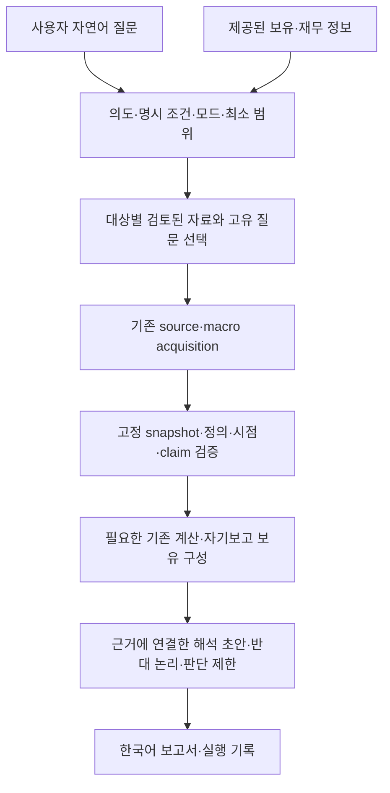

# 자연어 질문에서 실제 조사와 보고서까지

`ask`는 사용자의 질문에 필요한 자료를 선택하고 기존 수집·검증·계산 경로를 실행해 한국어 Markdown 보고서를 만든다. 사용자에게 연구 모드 이름이나 내부 입력 파일을 요구하지 않는다. 계획만 확인하려면 `--plan-only`를 사용한다. 네 진입점의 의미와 최소 범위 원칙은 [연구 모드 계약](research-modes.md)을 유지한다.

## 사용

Python 3.12 이상, 표준 라이브러리만 필요하다. 저장소 루트에서 실행한다.

```bash
python -m investment_research ask 'BTC 지금 어때?'
python -m investment_research ask '오늘 투자할 만한 곳 찾아줘'
python -m investment_research ask 'S&P500이랑 미국 국채 비교해줘'
python -m investment_research ask '천연가스 지금 들어갈 만해?'
python -m investment_research ask '내 포트폴리오 괜찮아?'
```

기본 실행은 검토된 공개 URL을 요청한다. `reports/asks/<UTC시각>_<질문해시>/`에 보고서와 실행 자료를 보존하고 표준 출력에 보고서, 표준 오류에 진행 상황과 경로를 출력한다. 이 디렉터리는 Git에서 제외되어 있다. 다음 옵션은 선택 사항이다.

```bash
python -m investment_research ask 'BTC 지금 어때?' --run-dir reports/btc_run
python -m investment_research ask 'BTC 지금 어때?' --output reports/btc_copy.md
python -m investment_research ask 'BTC 지금 어때?' --plan-only
python -m investment_research ask --replay reports/btc_run
python -m investment_research ask '내 포트폴리오 괜찮아?' --portfolio my_portfolio.json
python -m investment_research ask '지금 전체 투자판에서 내가 볼 만한 기회 찾아줘.' --previous-scan reports/my_completed_scan
```

`--run-dir`는 새 디렉터리여야 한다. `--output`은 기본 보고서 외의 사본이다. 새로운 live 실행에서 기존 파일을 덮어쓰지 않는다. replay는 원래 질문·모드·보유·기준 시각을 유지하며 인터넷을 호출하지 않는다. 질문을 바꾸거나 새 시점의 자료가 필요하면 새 ask를 실행한다. 원래 질문을 replay에 함께 적어도 같아야 한다. 종료 코드 0은 제한된 결과를 포함한 보고서 생성 완료, 2는 입력/출력 보호에 따른 차단, 1은 실행/파일 오류다. 투자 판단 유보나 미지원 범위가 종료 코드만으로 숨겨지지 않도록 보고서와 manifest의 연구 상태를 함께 확인한다.

명시적 `--mode` 반복 지정과 `Asset Deep Dive:` 등의 접두부도 유지한다. 일반 사용자는 지정할 필요가 없다. `--plan-only`는 기존 `research-plan-v1`, `execution_status: not_started` 계획을 출력하며 수집·분석을 실행하지 않는다.

Opportunity Scan의 `--previous-scan`은 완료된 이전 실행을 replay로 검증한 뒤 동일 source·정의·단위·통화·scope의 관측과 후보 변경을 비교한다. anchor는 새 입력에 보존하고 현재 자료는 새로 수집한다. `--context-run`의 후보 번호 해석과 구분하며 Deep Dive·Compare·Portfolio Review의 필수 조건으로 추가하지 않는다. [최소 coverage와 반복 관측](opportunity-scan.md)에 세 자료 상태, 새 연결/개정/시장 변화의 구분, `scan_observations.json`·`scan_changes.json`·manifest의 추적을 설명한다.

## 전체 실행과 책임



| 구현 | 역할 |
| --- | --- |
| `routing.py` | 규칙 기반 질문 해석·명시적 모드 우선·필요한 작업·확인할 질문 |
| `query_understanding.py` | 국가·지역·만기·전략·목적·시점·명시 제약과 원문 위치 보존; 재무 정보 추정 없음 |
| `research_catalog.py`, `catalog/` | 검토된 출처·원문 구절·정의·시점을 질문 범위로 투영; 원출처 관계 보존 |
| `orchestrator.py` | 위 입력과 기존 실행기를 조율; 새로운 수집기나 독립 금융 엔진을 만들지 않음 |
| `source_pipeline.py`, `sources.py` | 기존 획득·정책·불변 snapshot·구절 일치·주장 검증 |
| `macro_pipeline.py`, `macro.py` | 필요한 거시 series만 선택·당시 이용 가능한 판본·결정적 계산 |
| `opportunity.py` | source/macro의 정확한 cutoff와 근거 통합; Scan에서는 실제 Opportunity Map 객체도 생성 |
| `deep_dive.py` | S&P 500 대상에서 기존 원문 숫자 전사·이익수익률·동일 날짜 국채 차이 계산 재사용 |
| `portfolio.py` | 명시적 KRW 자기보고 값으로 보유액·비중·부채 차감·자금수요 합계 계산 |
| `orchestrator_report.py` | 질문별 한국어 본문·근거 부록·reasoning·manifest; 새 숫자/점수 생성 없음 |

Deep Dive와 Compare의 내부 source/macro adapter가 `replay_opportunity`를 재사용하는 것은 전체 시장 Scan을 수행한다는 뜻이 아니다. 실제로 선택한 URL·자산·series만 검증한다. S&P 500의 수치 방법은 미국 주식 scope에서만 사용하며 BTC·부동산에 P/E나 EPS를 강제하지 않는다. 기존 다섯 경로와 고정 예제는 보존한다.

## 모드별 실행 범위

| 질문 | 실제 실행 |
| --- | --- |
| BTC 지금 어때? | IBIT 상품 자료·제공자의 디지털자산 flow·관련 공개 토론·KRW 환율. 전체 flow와 BTC 단독 flow를 구분하며 가격·레버리지·network 연결의 공백 표시 |
| 천연가스 지금 들어갈 만해? | EIA 주간 재고와 전망·관련 KRW 노출. 실제/전망·지역·계절 비교·상품의 선물 교체 비용 구분 |
| 오늘 투자할 만한 곳 찾아줘 | [15영역 최소 조사](opportunity-scan.md)와 관련 macro로 기존 Opportunity Map 실행. 현재 근거가 있는 조건부 연구 후보와 반대 논리·누락 자료를 보고하며 투자 수익률 순위·매수·비중을 생성하지 않음 |
| S&P500이랑 미국 국채 비교해줘 | 두 대안의 자료와 현재 관련 금리·환율. 수익 원천·valuation 정의·이익 기대·손실 경로·기간·기회비용을 비교하고 가능한 기존 수치 계산 |
| Bitcoin vs 동탄 아파트 | 공통 자금·기간·유동성·통화 기준과 각각의 고유 수익 원천. 전국 정책을 동탄 특정 물건 가치로 대체하지 않음 |
| 내 포트폴리오 괜찮아? | 제공한 보유표부터 시작. 없으면 입력 공백 보고서이며 수집·비중 추정 없음. 있으면 계산 가능한 구성과 등록된 보유자산의 제한된 시장 근거 연결 |

Samsung 및 일부 미국 기업·ETF·배당/성장/가치 전략도 등록된 원자료 범위로 조사한다. [한국 자료 registry](korean-official-coverage.md)는 ECOS 국고채 1·3·5·10년, 삼성전자 공식 발표, SK하이닉스 IR 연결 제공자 실적, 서울·경기·인천 아파트 통계를 기존 실행기에 추가한다. 현재 시세/valuation·원공시 교차 확인·개별 거래 가격은 미완료다. Nasdaq·임의 상품·미지원 만기/단지는 다른 기업·미국 국채·전국 자료로 대체하지 않는다. 발행국을 생략한 “국채”는 이번에 미국 Treasury 자료만 확보했음을 명시하고 발행국·통화·만기를 미확인 조건으로 남긴다.

[질문 조건 보존](query-understanding.md)의 routing v4는 “한국 3년 국채”를 Compare의 독립 대안으로 유지하며 미국 단기 국채 방법에 연결하지 않는다. “서울/수도권 아파트”는 지역을 유지한 Deep Dive이며 공식 지역 자료만 연결하고 전국 자료와 환율을 지역 분석처럼 쓰지 않는다. “전체 투자판 … 기회”는 확인 질문 없이 [15영역 조건부 Scan](opportunity-scan.md)을 실행하고 근거가 있는 연구 후보를 선택한다. 질문의 이해와 원자료 지원 여부를 별도로 기록한다. 이번 coverage 변경은 routing/query parser를 변경하지 않았다.

Combined Mode는 지정한 작업의 출처 합집합을 한 번 수집하고 보고서를 조합한다. `전체 시장 보고 천연가스랑 한국 반도체는 깊게 봐줘`는 Scan과 지정한 두 심층 섹션을 생성한다. Portfolio + Compare는 보유·누락 제약과 대안 자체의 경제성을 따로 보여 준다. Scan에서 “가장 유망한 두 개”를 자동 선택하는 강한 비교 근거는 현재 제공하지 않는다. 해당 조건부 후속 작업은 `awaiting_supported_candidate`로 남기고 자동 심층 실행을 했다고 표시하지 않는다. 직접 지정한 Deep Dive에는 이 조건을 적용하지 않는다.

## Portfolio Review MVP 입력

`portfolio-v1`은 현재 KRW 평가액 입력만 지원한다. 외화 금액·환율·대략의 비중만으로 평가액을 역산하지 않는다. 금액은 Decimal 문자열, 미확인은 `null`이다. 현금은 `cash_krw`에 기록하고 holdings와 중복 입력하지 않는다.

```json
{
  "schema_version": "portfolio-v1",
  "as_of": "2026-10-04",
  "base_currency": "KRW",
  "coverage": "complete",
  "holdings": [
    {"id": "HOLDING_A", "name": "S&P500 ETF", "asset": "SPY", "value_krw": "6000000"},
    {"id": "HOLDING_B", "name": "Bitcoin", "asset": "BTC", "value_krw": "2000000"}
  ],
  "cash_krw": "2000000",
  "debt_krw": null,
  "monthly_investable_krw": null,
  "future_cash_needs": null,
  "horizon_months": null,
  "synthetic": true
}
```

위 값은 설명용 합성 금액이다. 실제 보유표에는 실제 자기보고 값과 전체성 `complete/partial/unknown`을 적는다. `synthetic`을 명시한 예제는 보고서에 합성 경고를 붙인다. `future_cash_needs`는 `{name, amount_krw, needed_at}` 목록이고 빈 목록은 알려진 예정 필요가 없다는 자기보고, `null`은 미확인이다. 투자기간은 `horizon_months`의 양의 정수다.

전체 보유라고 명시하고 모든 보유액·현금이 알려졌을 때만 전체 금액 비중을 계산한다. 알려진 현금만 보유한 완전한 목록도 지원한다. 부채가 알려지면 제공된 자산−부채를, 나열한 자금수요 금액이 모두 알려지면 명목 합계를 계산한다. 분모가 0이거나 일부 보유/현금이 누락되면 비중을 보류한다. 부채·월 투자액·자금수요·기간의 미확인은 구성 계산을 무조건 막지는 않지만 개인 적절성을 제한한다.

가장 큰 평가액 항목은 표시하지만 임의 기준으로 과도한 집중이라고 단정하지 않는다. ETF look-through 중복, 직업·주택과의 공통 위험, 부채 금리/상환 일정, 시점별 유동성 부족, 위험 capacity/tolerance, 최적 신규 배분은 아직 계산하지 않는다. 시장 매력·기존 보유·추가 보유의 적절성을 같은 결론으로 합치지 않는다. 사용자 보유 JSON을 외부 서비스로 전송하지 않고 로컬 실행 입력에 보존한다.

## 근거와 해석의 추적

금융 숫자는 기존 파싱·명시적 quote fact·MetricResult·자기보고 값에서만 나온다. 동일 기간·정의·통화가 없는 값을 미래 수익률 순위로 만들지 않는다. 주식 이익수익률−Treasury 차이는 설명용 비교이며 ERP·확정 기대수익이 아니다.

`catalog/findings.json`의 한국어 해석 초안은 연결된 원문과 definition의 fingerprint가 일치하고 필요한 비커뮤니티 근거가 모두 현재성 조건을 만족할 때만 본문에 나타난다. 원문·정의 변경, 미확보, stale/future/unknown, scope 불일치이면 해당 문장을 보류한다. **검증된 원문 존재와 경제적 의미 검토 완료는 다르다.** 이 초안과 신규 가설은 `pending/unverified`로 유지하고, macro의 좁은 결정적 계산 사실만 기존 검증 상태를 유지한다. 공개 토론은 발언 관측이며 내용·대표성·투자 우위가 확인되었다고 말하지 않는다.

“왜 그렇게 판단했어?”에 대응할 수 있도록 본문의 판단·계산·원자료 링크를 부록으로 연결한다. manifest는 reasoning별 evidence/metric, 반대 설명, 재검토 조건을 보존한다. 원문이 있는 영어는 부록에서 확인할 수 있고 본문에는 검토된 한국어 설명을 제공한다. 자유로운 LLM 생성이나 모델 점수는 사용하지 않는다.

| 실행 artifact | 보존하는 내용 |
| --- | --- |
| `started.json` | 원래 질문·시작 시각 |
| `input.json` | 질문·해석한 모드/작업·최소 대상·방법·입력 profile·필요한 quote fact/해석만·catalog/method hash |
| `plan.understanding`, manifest의 `query_understanding`·작업의 `condition_coverage` | 원문·의도·국가/지역/만기·목적/제약과 해당 조건의 지원 여부; 자료 부족이어도 조건 보존 |
| `source_plan.json`, `source_pins.json`, `source_snapshots/` | 질문에 선택한 출처·원출처 관계·구절·검토 상태·정책·snapshot |
| `macro_plan.json`, `macro_pins.json`, `macro_snapshots/` | 관련 series·정의·공개/관측/획득/vintage·원관측 |
| 해당하는 `evidence_review.json`, `opportunity_review.json`, `deep_review.json` | 기존 replay에 전달한 검토 전 연구 입력 |
| `report.md` | 한국어 최종 결과와 근거 부록 |
| `run_manifest.json` | 모드별 결과 상태·실제 pipeline 호출·accessed sources·used evidence·evaluated claims·계산·reasoning·누락 질문·해시·report 경로 |
| 실패 시 `failed.json` | 실행 오류 유형과 진단; 정상적인 근거 부족과 구분 |

실행 완료와 연구 강도를 분리한다. 연구 상태는 `partial/needs_input/unsupported/needs_clarification/completed`이고 모드별 결과도 별도로 기록한다. 기존 run ID와 subject ID는 후속 연결의 참조점이다. “아까…”를 자동으로 이전 실행에 연결하는 대화 기억 엔진은 아직 없다.

Replay는 입력·자료·보고서 체크섬과 방법 버전을 검사하고 동일 cutoff에서 다시 계산한 보고서의 바이트를 원본과 비교한다. 재실행으로 입력·판본·manifest를 덮어쓰지 않는다. 과거 creation code hash는 그대로 유지한다. 기존 예제의 오래된 분석을 날짜만 바꾸어 새 분석으로 게시하지 않는다.

## 현재 한계와 검증

BTC에는 [Source Discovery & Freshness](source-discovery.md)를 수집 앞단에 연결했다. 질문에서 선택한 need의 공개 목록·발행자 링크·community 검색으로 새 최종 URL·관측·판본을 찾고 기존 SourcePlan·snapshot·claim verification에 넣는다. 가격만/ETF 흐름만 묻는 질문은 해당 범주만 발견하며 검색 snippet을 근거로 사용하지 않는다. 실제 거래소 가격/거래량·한 선물 계약·제공자의 최신 BTC ETF 행을 확인할 수 있다. 최신 미완성 ETF 행의 잠정 합계를 전체 확정 순유입으로 채우지 않는다. publication unknown을 획득일로 바꾸거나 과거 완성판을 최신판처럼 사용하지 않는다.

한국 투자자에게 남은 실용적 한계는 **한국 기업의 원공시·정정판·이익 귀속과 KRX 시세 대조, 개별 아파트 가격/공급/대출**이다. 공식 지역 실거래지수는 개별 거래 가격을 대체하지 않는다. 검토된 publisher/형식을 벗어난 근거의 자동 승격, BTC 전체 레버리지/network/적정 가치·발행사별 ETF 교차 확인·전체 consensus·상품/세금 자료도 미완료다. 미검토 source는 기존 데이터로 대신하지 않고 gap으로 공개한다. 모든 자연어를 이해하는 범용 모델이나 모든 자산의 완전한 Deep Dive 실행기는 아니다.

기존 205개와 새 orchestration 31개, 전체 **236개 오프라인 테스트**를 유지한다. 계획 CLI 회귀는 `--plan-only`로 명시했다. 실제 acquisition/verification 호출, 네 모드·조합·최소 범위·미지원·unknown/partial/현금만 보유·금액 검산·원출처·정의 변경/서사 승격 차단·미래/stale·보고서 링크·출력 보호·인터넷 없는 동일 replay를 확인한다. 외부 서비스 성공 여부를 일반 unit test의 조건으로 사용하지 않는다. 실제 live 자료 예제와 합성 보유 예제는 [사례 안내](../examples/ask_orchestrator/README.md)에서 구분한다.

이후 discovery 37개·query understanding 23개·한국 자료 29개를 추가해 **325개**가 offline으로 통과했다. `discovery.json`과 manifest의 `source_discovery`에 need·검색/목록·원문/정책 hash·후보/거절·판본·freshness·승격 evidence·community verification·gap을 보존한다. Replay는 routing v2/v3 입력도 재해석하지 않고 저장된 scope와 원래 보고서 그대로 재현한다. 원래 다섯 ask 예제와 과거 source/macro/Opportunity Map/Deep Dive 파일은 덮어쓰지 않았다. [실제 BTC 전후 검증](../examples/source_discovery/README.md), [여섯 질문 회귀 기록](../reports/query_understanding_regression_20261005T080806Z/regression_report.md), [한국 자료 전후 검증](../reports/korean_coverage_validation_20261005T092721Z/coverage_validation.md)을 별도 사례로 보존한다.

[반도체 비교](korean-semiconductor-comparison.md)는 공식 삼성 제표·국내 표시 종가·같은 산술의 TTM 배수·이익의 질까지 연결했지만 SK하이닉스 배수는 잠정이다. 선택적 `semiconductor_coverage`가 있는 새 입력만 해당 계약과 `company_comparison.json`을 사용하며 과거 입력은 기존 경로를 재생한다. 새 27개를 포함한 총 **352개** 테스트, 기존 23개 ask와 새 비교, source/macro/Opportunity Map/Deep Dive의 보고서 바이트를 offline으로 확인했고 기존 670개 예제/보고서/질문 해석 파일을 보존했다. [실제 비교 전후 검증](../reports/semiconductor_comparison_validation_20261005T121543Z/coverage_validation.md)에 결과를 둔다.
